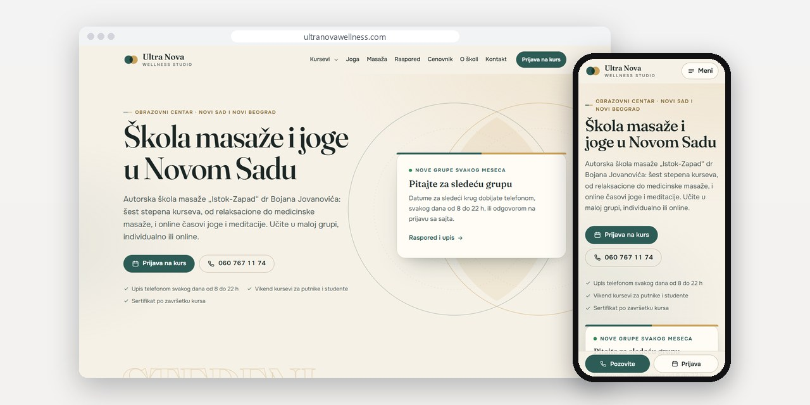
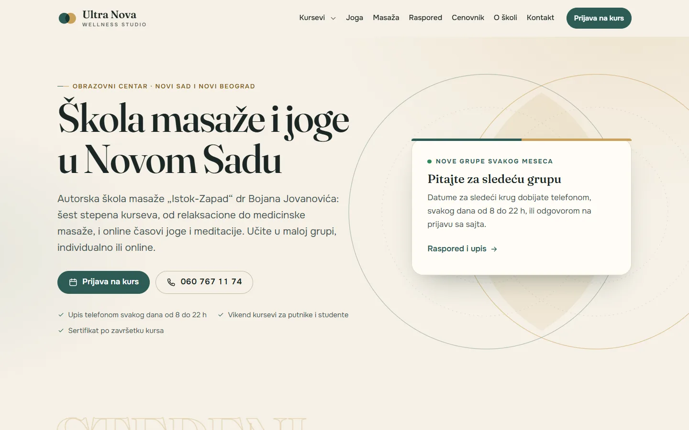
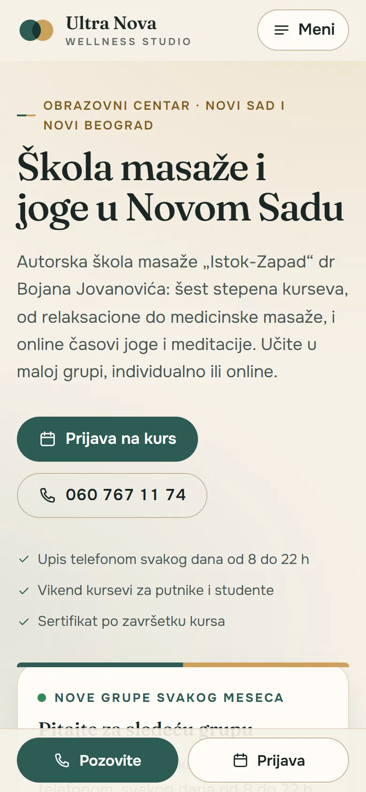
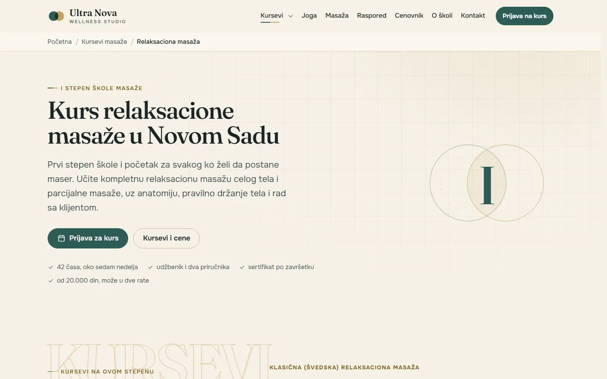
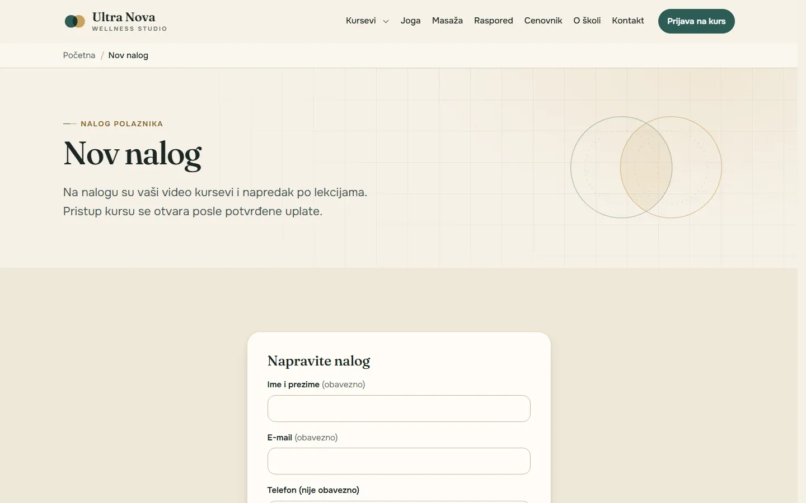

# Ultra Nova

A site for a massage and yoga school from Novi Sad, with six course levels, a group schedule, course sign-up and student accounts for video courses.

**[ultranovawellness.com](https://ultranovawellness.com/)** · [Case study](https://svilenkovic.com/portfolio/ultra-nova) · [Srpski](README.sr.md)

> [!NOTE]
> Client project. The source code belongs to the client and stays in a private repository. This page describes what I built and how.

<table>
  <tr><td><b>Client</b></td><td>Ultra Nova Wellness Studio</td></tr>
  <tr><td><b>Industry</b></td><td>Massage school, yoga and massage</td></tr>
  <tr><td><b>Location</b></td><td>Novi Sad, Serbia</td></tr>
  <tr><td><b>Type</b></td><td>Multi-page website with student accounts</td></tr>
  <tr><td><b>My role</b></td><td>Design, development, SEO and hosting</td></tr>
  <tr><td><b>Stack</b></td><td>Astro, TypeScript, PHP 8.5, SQLite, JSON-LD</td></tr>
</table>

## About the project

Ultra Nova is an education center with its own massage school, “Istok-Zapad” (East-West), taught in six levels, along with online yoga and meditation and massage by appointment. Classes run in Novi Sad, in Novi Beograd and online. The school moved to a new domain and needed a standalone site with its courses, schedule and sign-up.

Each of the six levels, from relaxation to medical massage, has its own page with the program, materials, dates and questions. Behind the public site is a school section in PHP and SQLite: an account is created only after the email address is confirmed, a video course opens once the school confirms the bank transfer, books are paid on delivery, and the school has its own admin area for payments and orders. The first video courses are still being recorded, so until then those pages point to classes in person and to the school's phone.

## What I built

- 16 pages, with one page for each of the six levels of the school and a separate page for the price list
- A schedule of group start dates by course and location, which also feeds the dates in the sign-up form
- Student accounts confirmed by email, and video lessons that play only with paid access and remember where the student stopped
- Payment by bank transfer through a QR code for banking apps, or in cash in class
- Book orders paid on delivery, and an admin area with a visit counter that sets no cookie and keeps no IP address
- A YouTube lesson that loads only when played, and analytics only after consent

## Results

| | Performance | Accessibility | Best practices | SEO |
| :-- | :-: | :-: | :-: | :-: |
| Mobile | 99 | 100 | 100 | 100 |
| Desktop | 100 | 100 | 100 | 100 |

PageSpeed Insights, lab test of the live site, November 2026. Security headers: 6 of 6. HTML validator: no errors. axe accessibility check: no violations. Structured data: `EducationalOrganization`, `FAQPage`, `HealthAndBeautyBusiness`.

## Screenshots

<table>
  <tr>
    <td width="68%" valign="top"></td>
    <td width="32%" valign="top"></td>
  </tr>
</table>

The first level of the school: length, materials and certificate right below the title

The student account: video courses and lesson progress, with access opened after a confirmed payment

---

Built by [D. Svilenković](https://svilenkovic.com).
