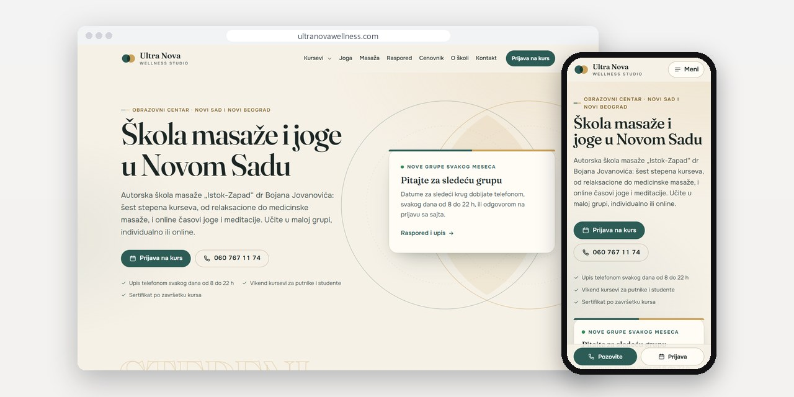
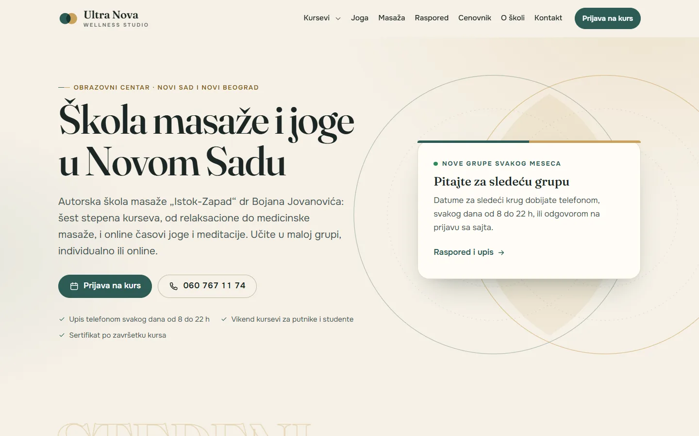
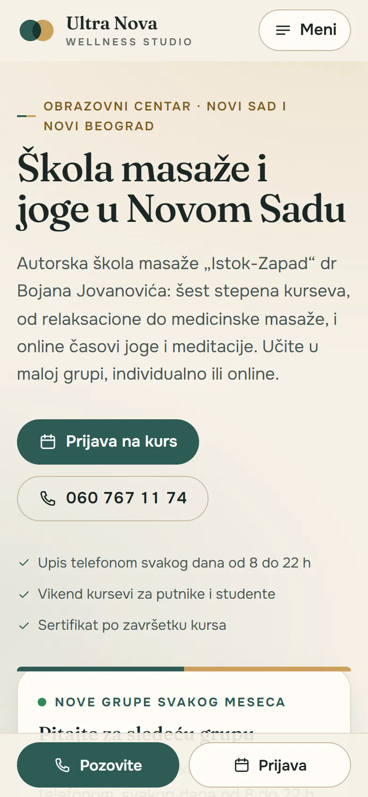
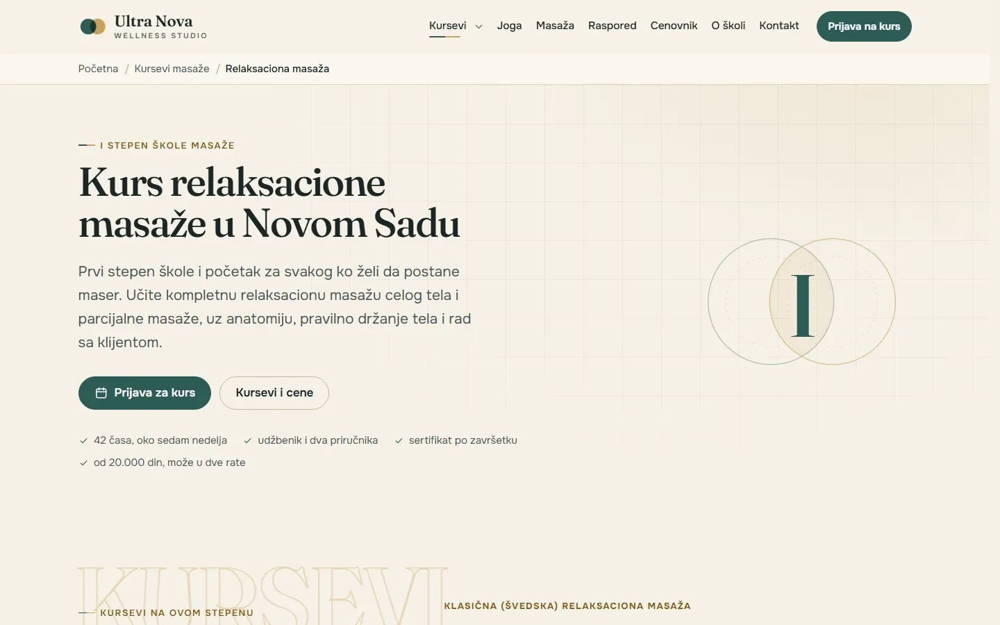
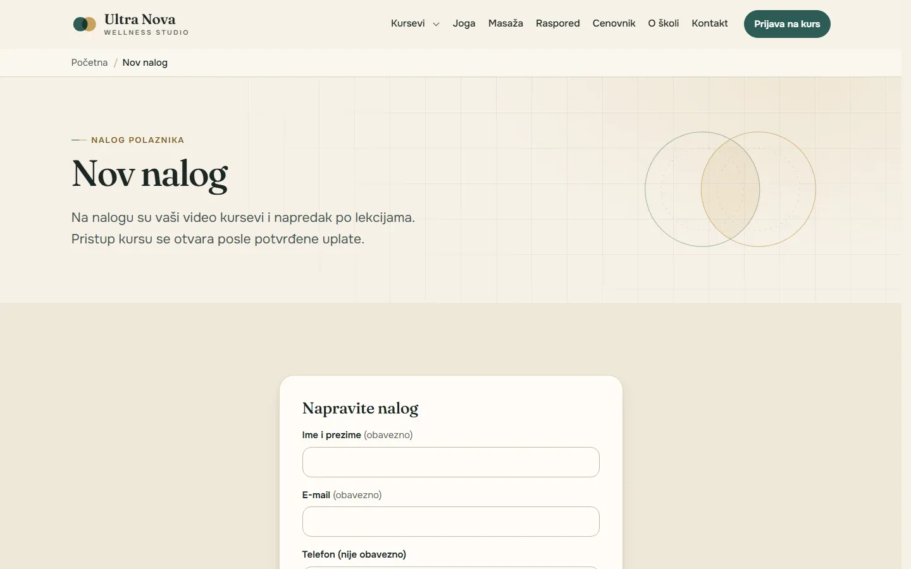

# Ultra Nova

Sajt škole masaže i joge iz Novog Sada, sa šest stepena kurseva, rasporedom grupa, prijavom na kurs i nalogom polaznika za video kurseve.

**[ultranovawellness.com](https://ultranovawellness.com/)** · [Studija slučaja](https://svilenkovic.rs/radovi/ultra-nova) · [English](README.md)

> [!NOTE]
> Klijentski projekat. Izvorni kod pripada klijentu i čuva se u privatnom repozitorijumu. Ova stranica opisuje šta sam uradio i kako.

<table>
  <tr><td><b>Klijent</b></td><td>Ultra Nova Wellness Studio</td></tr>
  <tr><td><b>Delatnost</b></td><td>Škola masaže, joga i masaže</td></tr>
  <tr><td><b>Lokacija</b></td><td>Novi Sad</td></tr>
  <tr><td><b>Vrsta</b></td><td>Sajt sa više strana i nalogom polaznika</td></tr>
  <tr><td><b>Moj deo posla</b></td><td>Dizajn, izrada, SEO i hosting</td></tr>
  <tr><td><b>Tehnologije</b></td><td>Astro, TypeScript, PHP 8.5, SQLite, JSON-LD</td></tr>
</table>

## O projektu

Ultra Nova je obrazovni centar sa autorskom školom masaže „Istok-Zapad” u šest stepena, online školom joge i meditacije i masažama po dogovoru. Nastava se drži u Novom Sadu, na Novom Beogradu i online. Škola je prešla na nov domen i trebao joj je samostalan sajt sa kursevima, rasporedom i prijavom.

Svaki od šest stepena, od relaksacione do medicinske masaže, ima svoju stranu sa programom, materijalom, terminima i čestim pitanjima. Iza javnog dela je školski deo u PHP-u sa SQLite bazom: nalog nastaje tek kada polaznik potvrdi adresu iz mejla, video kurs se otvara kada škola potvrdi uplatu na račun, knjige se plaćaju pouzećem, a škola ima svoju administraciju za uplate i porudžbine. Prvi video kursevi se još snimaju, pa te strane do tada upućuju na nastavu uživo i na telefon škole.

## Šta sam uradio

- 16 strana, sa po jednom stranom za svaki od šest stepena škole i posebnom stranom za cenovnik
- Raspored datuma početka grupa po kursu i mestu, iz koga dolaze i termini u prijavi
- Nalog polaznika potvrđen mejlom i video lekcije koje se puštaju samo uz plaćen pristup i pamte dokle je polaznik stigao
- Plaćanje uplatom na račun preko QR koda za aplikaciju banke ili gotovinom u učionici
- Porudžbina knjiga pouzećem i administracija sa brojačem poseta koji ne pravi kolačić i ne čuva IP adresu
- YouTube lekcija koja se učitava tek kada se pusti i analitika samo uz pristanak

## Merenja

| | Performanse | Pristupačnost | Dobre prakse | SEO |
| :-- | :-: | :-: | :-: | :-: |
| Telefon | 99 | 100 | 100 | 100 |
| Desktop | 100 | 100 | 100 | 100 |

PageSpeed Insights, laboratorijsko merenje živog sajta, novembar 2026. Sigurnosna zaglavlja: 6 od 6. HTML validator: bez grešaka. axe provera pristupačnosti: bez prekršaja. Strukturisani podaci: `EducationalOrganization`, `FAQPage`, `HealthAndBeautyBusiness`.

## Snimci ekrana

<table>
  <tr>
    <td width="68%" valign="top"></td>
    <td width="32%" valign="top"></td>
  </tr>
</table>

Prvi stepen škole: trajanje, materijal i sertifikat odmah ispod naslova

Nalog polaznika: video kursevi i napredak po lekcijama, a pristup kursu se otvara posle potvrđene uplate

---

Izrada: [D. Svilenković](https://svilenkovic.rs).
